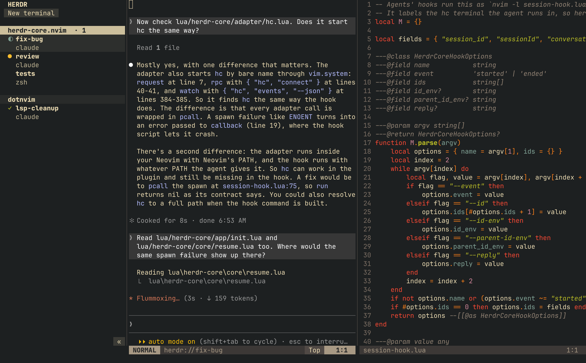

# herdr-core.nvim

A TUI client for [herdr-core](https://github.com/herdrdev/herdr-core), built on Neovim.



## Features

- A sidebar groups sessions into spaces by Git repository or working directory, automatically tracking `cd`.
- Shows each agent's status icon in the sidebar.
- Sends OS notifications when an agent needs you or finishes.
- Restores terminal layouts when Neovim restarts.
- Automatically resumes agent conversations after a reboot.
- Built-in integrations for Claude Code, Codex, Antigravity CLI, Copilot CLI, Cursor CLI, Droid, Grok, Kilo Code, Mastra Code, omp, opencode, pi, Qoder CLI and Qwen Code. You can [write your own](#custom-integrations).
- Lists your own items in the sidebar, under a terminal or in a section of their own. See [Custom resources](#custom-resources).

## Limitations

- Session restoring plugins (e.g. persisted.nvim, auto-session) may conflict with this plugin. Terminal sessions can be restored with this plugin.
- Terminals on other machines are not listed in the sidebar yet.

## Usage

| Input | Action |
| --- | --- |
| `j`, `k` / `Up`, `Down` | Move selection |
| Select terminal session and press `Enter` / Click it | Open it |
| Select `New terminal` and press `Enter` / Click it | Start a terminal session in a space you pick |
| Select terminal session and press `n` | Start a terminal session in its space |
| Select terminal session and press `r` | Name it |
| Select terminal session and press `p` | Pin it |
| Select terminal session and press `u` | Mark it unread |
| Right-click a terminal session | Choose one of these actions from a menu |
| Select `«` or `»` and press `Enter` / Click it | Toggle the sidebar |

## Requirements

- Neovim 0.11 or later
- `hc` on your PATH
- Git

## Installation and configuration

With lazy.nvim:

The plugin maps no global keys.

```lua
{
    "takagiy/herdr-core.nvim",
    lazy = false,
    config = function()
        local app = require("herdr-core").setup({
            -- Enter terminal mode when the cursor moves into a terminal window.
            auto_insert = true,
            -- Width of the sidebar.
            sidebar_width = 24,
            -- What the sidebar lists, in order. See Custom resources below.
            resources = {
                -- The spaces with their terminals, and what a key does on a terminal.
                require("herdr-core.resources").terminals({
                    keys = { use = "open", n = "new_terminal", r = "rename", p = "pin", u = "unread" },
                }),
            },
            -- Custom how notifications are sent.
            notify = function(name, status)
                ...
            end,
            -- Custom picker UI.
            picker = function(items, options, on_choice)
                ...
            end,
            -- Custom agent integrations. See Custom integrations below.
            integrations = {},
        })
        if not app.actions then return end
        vim.keymap.set("n", "<leader>ht", app.actions.new_tab)
        vim.keymap.set("n", "<leader>hv", app.actions.new_vertical)
        vim.keymap.set("n", "<leader>hs", app.actions.new_horizontal)
        vim.keymap.set("n", "<leader>hb", app.actions.toggle_sidebar)
        vim.keymap.set("n", "<leader>hf", app.actions.focus_sidebar)
    end,
}
```

In the terminals' `keys`, the actions are `open`, `rename`, `pin`, `unread` and `new_terminal`. `use` stands for Enter and a click. `sidebar_keys` is no longer used.

### Statusline

If you use a statusline plugin, e.g. lualine, turn it off for the sidebar:

```lua
require("lualine").setup({
    options = {
        disabled_filetypes = { statusline = { "herdr-core" } },
    },
})
```

### Custom resources

A resource lists sections and items in the sidebar. The sidebar draws them like its own rows.

```lua
local resources = require("herdr-core.resources")
local Section, Item = resources.Section, resources.Item

require("herdr-core").setup({
    resources = {
        resources.terminals(),
        -- Lists items under each terminal.
        {
            name = "tasks",
            -- `terminals[]` is each space, `terminals[][]` each terminal in a space,
            -- `terminals[][][]` each terminal one of those started.
            parent = "terminals[][]",
            -- Makes the monitor of one parent. It is called once for each parent.
            monitor = function()
                local timer
                return {
                    -- Called when the parent appears and each time it changes.
                    -- ctx.parent is the parent. A terminal's props hold address, space and is_pinned.
                    arm = function(ctx)
                        if timer then return end
                        timer = assert(vim.uv.new_timer())
                        timer:start(0, 5000, function()
                            -- Replaces what this resource lists under the parent.
                            -- ctx.notify can be called from any callback.
                            ctx.notify({
                                Item({
                                    name = "T12",
                                    -- Optional: a second line, a status icon, a count, a background,
                                    -- items one level deeper, and whatever your actions need.
                                    detail = "fix login",
                                    status = "working", -- or "blocked", "error", "done", "idle"
                                    notification_count = 1,
                                    is_highlighted = false,
                                    items = { Item({ name = "write the test" }) },
                                    props = { number = 12 },
                                }),
                            })
                        end)
                    end,
                    -- Called once, when the parent goes away or the plugin stops.
                    disarm = function()
                        if timer then
                            timer:stop()
                            timer:close()
                        end
                    end,
                }
            end,
            actions = {
                open = function(ctx)
                    -- ctx.item is the item as you notified it.
                    -- ctx.parent is the terminal it is under.
                end,
            },
            -- A key runs an action by name, or a function. Only on this resource's items.
            keys = { use = "open", d = function(ctx) ... end },
        },
        -- Without a parent, lists what it notifies at the top, in the order of `resources`.
        {
            name = "notes",
            monitor = function()
                return {
                    arm = function(ctx)
                        ctx.notify({ Section({ name = "Notes", items = { Item({ name = "call back" }) } }) })
                    end,
                    disarm = function() end,
                }
            end,
        },
    },
})
```

- A resource with a parent notifies items. Without a parent it notifies sections, items, or both; an item at the top has no heading.
- An element with an `id` stays the same element across notifications. Give one to what other resources list under.
- `arm` decides by itself whether to watch something else when the parent has changed.
- A right click on an item opens a menu of its resource's `actions`, with or without keys. A function written in `keys` is not in the menu.
### Custom integrations

```lua
integrations = {
    -- Turns off a built-in integration.
    codex = false,
    -- Overrides part of a built-in integration.
    claude = {
        resume_command = function(id)
            return "claude --resume " .. id .. " --model opus"
        end,
    },
    -- Adds an agent.
    myagent = {
        -- Finds the agent's settings folder.
        -- Returns its path, or nil when the agent is not installed.
        directory = function()
            local path = vim.fs.normalize("~/.myagent")
            return vim.fn.isdirectory(path) == 1 and path or nil
        end,
        install = {
            {
                -- Checks the hooks are installed.
                -- Returns "installed", "outdated" or "missing".
                check = function(context)
                    local file = context.directory .. "/hooks.txt"
                    if vim.fn.filereadable(file) == 0 then return "missing" end
                    local wanted = { context.hook_command("started"), context.hook_command("ended") }
                    return vim.deep_equal(vim.fn.readfile(file), wanted) and "installed" or "outdated"
                end,
                -- Installs the hooks.
                apply = function(context)
                    local hooks = { context.hook_command("started"), context.hook_command("ended") }
                    vim.fn.writefile(hooks, context.directory .. "/hooks.txt")
                end,
            },
        },
        -- Builds the command that resumes a conversation.
        resume_command = function(id)
            return "myagent --resume " .. id
        end,
        -- Checks the terminal's program is this agent.
        matches_program = function(program)
            return program.name == "myagent" or (program.argv or {})[1] == "myagent"
        end,
    },
},
```

You can use these helpers to write an integration:

```lua
local integrations = require("herdr-core.integrations")

-- For directory: the folder named by the variable, or path when the variable is unset.
integrations.directory({ env = "MYAGENT_HOME", path = "~/.myagent" })
-- For install: sets or appends a value at a key in a JSON or JSONC settings file.
integrations.json({
    file = "hooks.json",
    events = { started = "SessionStart", ended = "SessionEnd" },
    append = { ["hooks.{{event}}"] = { type = "command", command = "{{command}}" } },
    set = { version = 1 },
})
-- For install: sets keys in a TOML settings file.
integrations.toml({ file = "config.toml", set = { ["features.hooks"] = true } })
-- For install: writes a file from a template, such as an extension the agent loads.
-- {{start_command}} and {{end_command}} become the hook commands.
integrations.template({ path = "extensions/herdr.js", source = vim.fn.expand("~/herdr-template.js") })
-- For matches_program: also recognizes programs run through node, npx and other interpreters.
integrations.program({ "myagent" })
```
